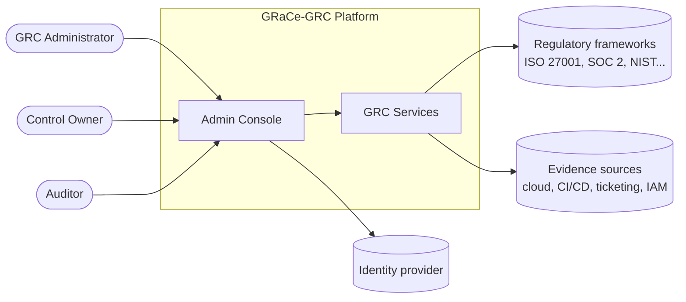

# System context

Who uses GRaCe-GRC and which external systems it talks to.

## Actors
- **GRC Administrator**: manages frameworks, controls and mappings.
- **Control Owner**: owns controls and responds to failures.
- **Auditor**: reviews evidence and reports.

## Open questions
- Which frameworks are in scope for the first release?
- Which evidence sources come first?
