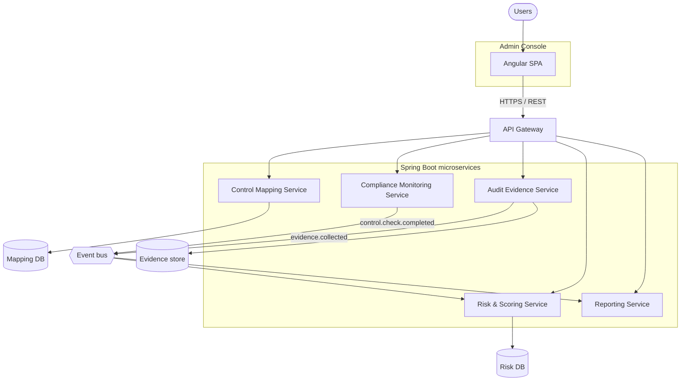

# Containers

The deployable pieces of GRaCe-GRC and how they communicate.

| Container | Technology | Owner initiative |
|---|---|---|
| Admin Console | TypeScript, Angular | All |
| Control Mapping Service | Java, Spring Boot | Control Mapping |
| Compliance Monitoring Service | Java, Spring Boot | Continuous Compliance |
| Audit Evidence Service | Java, Spring Boot | Continuous Compliance |
| Risk & Scoring Service | Java, Spring Boot | Risk & Reporting |
| Reporting Service | Java, Spring Boot | Risk & Reporting |

> Draft: service boundaries, the event bus technology and data stores are still to be decided. Record each decision as an ADR.
