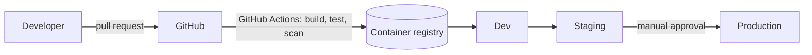

# Deployment (high level)

> Keep this page conceptual. Do not add hostnames, IP ranges, account IDs or network details to this public repository.

## To decide
- Runtime platform (e.g. Kubernetes, managed containers)
- Environments and promotion rules
- Secrets management
