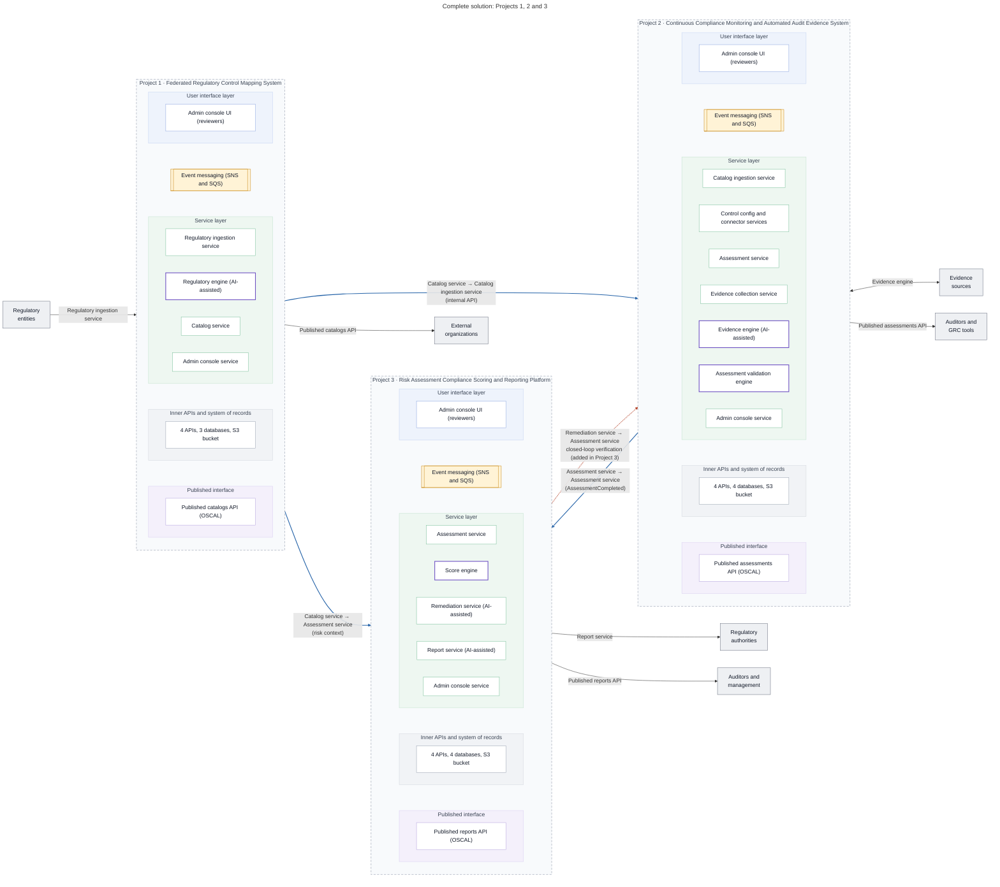
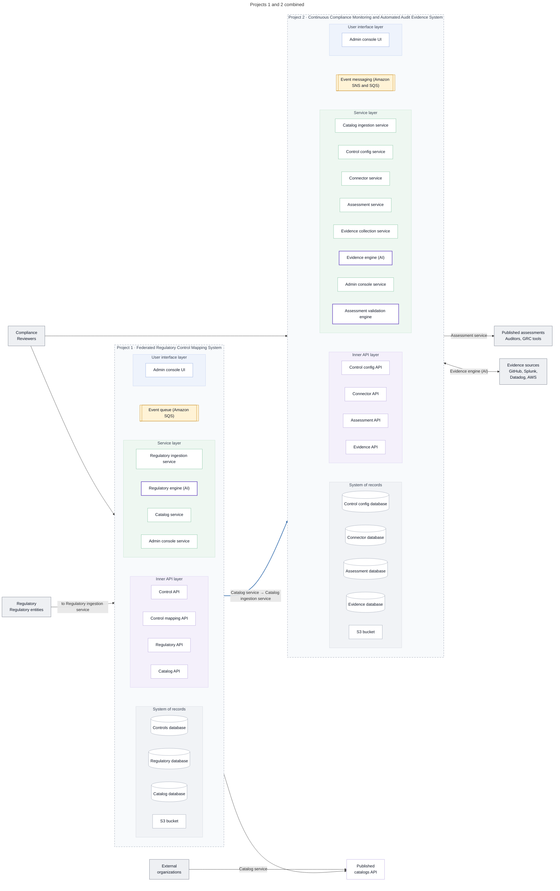

# Solution architecture

GRaCe-GRC is delivered as three projects that build on each other:

1. **Federated Regulatory Control Mapping System** turns regulatory files into reviewed controls, control mappings and OSCAL catalogs.
2. **Continuous Compliance Monitoring and Automated Audit Evidence System** turns those catalogs into configured tests, automated evidence collection and OSCAL assessment results.
3. **Risk Assessment Compliance Scoring and Reporting Platform** turns assessment results into risk scores, remediations with closed-loop verification, approved reports and OSCAL POA&M.

Each project follows the same layering: user interface, event messaging, service layer,
inner APIs and system of records. Each project owns its own databases; projects exchange
data only through internal service APIs and events, referring to each other's entities by ID.

## Complete solution

**Figure 12.3: Complete solution, Projects 1, 2 and 3**

<!-- mermaid-source: assets/diagrams/solution/fig-12-3-complete-solution.mmd -->

<!-- /mermaid-source -->

Files: [SVG](../assets/diagrams/solution/fig-12-3-complete-solution.svg) · [PNG](../assets/diagrams/solution/fig-12-3-complete-solution.png) · [Original](../assets/diagrams/solution/fig-12-3-complete-solution.original.png) · [Mermaid source](../assets/diagrams/solution/fig-12-3-complete-solution.mmd)

## Projects 1 and 2 combined

**Figure 11.3: Projects 1 and 2 combined**

<!-- mermaid-source: assets/diagrams/solution/fig-11-3-projects-1-2-combined.mmd -->

<!-- /mermaid-source -->

Files: [SVG](../assets/diagrams/solution/fig-11-3-projects-1-2-combined.svg) · [PNG](../assets/diagrams/solution/fig-11-3-projects-1-2-combined.png) · [Original](../assets/diagrams/solution/fig-11-3-projects-1-2-combined.original.png) · [Mermaid source](../assets/diagrams/solution/fig-11-3-projects-1-2-combined.mmd)

## Per-project architecture
- [Project 1 architecture](../systems/control-mapping/README.md#architecture)
- [Project 2 architecture](../systems/continuous-compliance/README.md#architecture)
- [Project 3 architecture](../systems/risk-reporting/README.md#architecture)

## Repositories
The repository for each component is listed in [Repositories](repositories.md).
