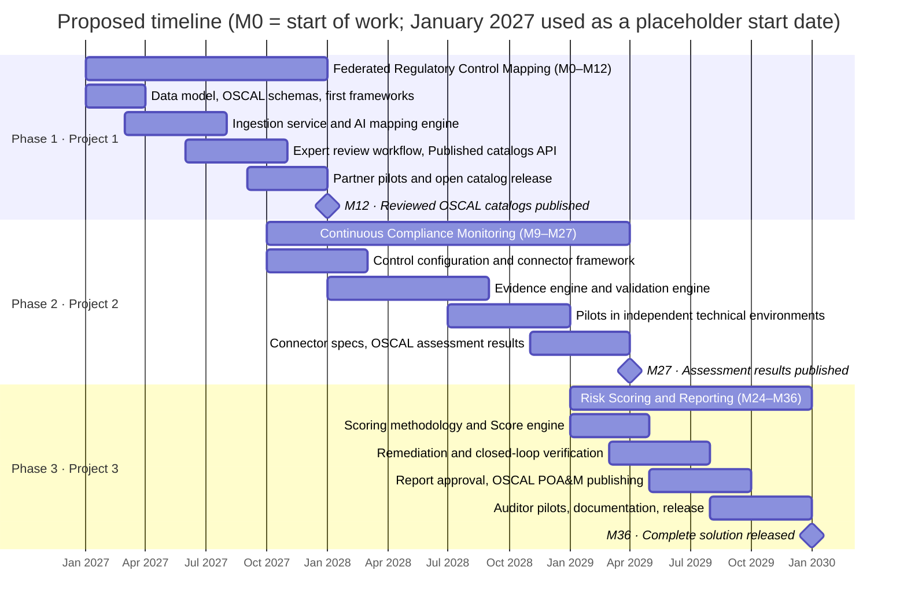

# Roadmap

Three overlapping phases over 36 months. Each project starts while the previous one is in its pilot stage.

**Figure 13.1: Proposed timeline**

<!-- mermaid-source: assets/diagrams/solution/fig-13-1-timeline.mmd -->

<!-- /mermaid-source -->

Files: [SVG](../assets/diagrams/solution/fig-13-1-timeline.svg) · [PNG](../assets/diagrams/solution/fig-13-1-timeline.png) · [Original](../assets/diagrams/solution/fig-13-1-timeline.original.png) · [Mermaid source](../assets/diagrams/solution/fig-13-1-timeline.mmd)

> Months are counted from the start of the work. The Mermaid version uses January 2027 as a placeholder start date; set real dates on the Roadmap project.

| Phase | Project | Months | Milestone |
|---|---|---|---|
| 1 | Federated Regulatory Control Mapping System | M0–M12 | M12: reviewed OSCAL catalogs published |
| 2 | Continuous Compliance Monitoring and Automated Audit Evidence System | M9–M27 | M27: assessment results published |
| 3 | Risk Assessment Compliance Scoring and Reporting Platform | M24–M36 | M36: complete solution released |

## Solution at the end of each phase
| Figure | End of phase | Diagram |
|---|---|---|
| 13.2 | Phase 1 | [Project 1 architecture](../systems/control-mapping/README.md#architecture) |
| 13.3 | Phase 2 | [Projects 1 and 2 combined](README.md#projects-1-and-2-combined) |
| 13.4 | Phase 3 | [Complete solution](README.md#complete-solution) |
