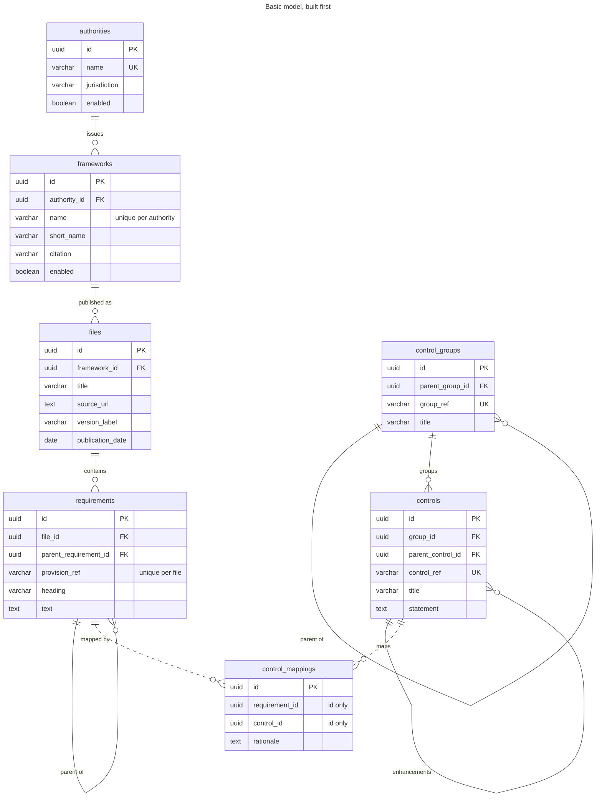

# Data model

Each project owns its own databases. Links between projects are identifiers (marked **REF**),
read through the owning project's internal service API, not foreign keys.

## Naming
- Table names are plural and have no prefix: `authorities`, `frameworks`, `files`, `requirements`.
- Foreign key columns are the singular table name plus `_id`: `authority_id`, `framework_id`, `file_id`.
- New tables follow the same rule. Tables of the regulatory database already use it; the other
  databases are renamed when their tables are built.

## Regulatory database: authorities
The first table built. It records the regulatory authorities that publish frameworks.

| Column | Type | Rules |
|---|---|---|
| `id` | `uuid` | Primary key |
| `name` | `varchar(255)` | Required, unique |
| `jurisdiction` | `varchar(255)` | Required |
| `created_at` | `timestamptz` | Set on insert, never changed |
| `enabled` | `boolean` | Required, defaults to `true` |
| `created_by` | `varchar(255)` | Required, set on insert, never changed |

## Basic model (built first)
The tables below are what is built first: identifiers, the links between entities and the same
audit columns as `authorities`. They grow towards the target model (the simplified and complete
models below) as each entity is mapped to OSCAL.

**Basic model**

<!-- mermaid-source: assets/diagrams/data-model/basic-model.mmd -->

<!-- /mermaid-source -->

Files: [SVG](../assets/diagrams/data-model/basic-model.svg) · [PNG](../assets/diagrams/data-model/basic-model.png) · [Mermaid source](../assets/diagrams/data-model/basic-model.mmd)

Solid lines are foreign keys. Dashed lines are ids across schemas, without foreign keys.

| Database | Schema | Tables | Owner |
|---|---|---|---|
| `regulatory` | `public` | `authorities`, `frameworks`, `files`, `requirements` | regulatory-api |
| `controls` | `controls` | `control_groups`, `controls` | control-api |
| `controls` | `control_mappings` | `control_mappings` | control-mapping-api |

Deleting a row that still has children returns `409`: an authority with frameworks, a framework
with files, a file with requirements, a requirement with child requirements, a control group with
groups or controls, and a control with enhancements.

### frameworks
| Column | Type | Rules |
|---|---|---|
| `id` | `uuid` | Primary key |
| `authority_id` | `uuid` | Required, references `authorities` |
| `name` | `varchar(255)` | Required, unique per authority |
| `short_name` | `varchar(255)` | Optional |
| `citation` | `varchar(255)` | Optional |
| `enabled` | `boolean` | Required, defaults to `true` |
| `created_at` | `timestamptz` | Set on insert, never changed |
| `created_by` | `varchar(255)` | Required, set on insert, never changed |

### files
| Column | Type | Rules |
|---|---|---|
| `id` | `uuid` | Primary key |
| `framework_id` | `uuid` | Required, references `frameworks` |
| `title` | `varchar(255)` | Required |
| `source_url` | `text` | Optional |
| `version_label` | `varchar(255)` | Optional |
| `publication_date` | `date` | Optional |
| `created_at` | `timestamptz` | Set on insert, never changed |
| `created_by` | `varchar(255)` | Required, set on insert, never changed |

### requirements
| Column | Type | Rules |
|---|---|---|
| `id` | `uuid` | Primary key |
| `file_id` | `uuid` | Required, references `files` |
| `parent_requirement_id` | `uuid` | Optional, references `requirements` |
| `provision_ref` | `varchar(255)` | Required, unique per file (e.g. `164.308(a)(4)(i)`) |
| `heading` | `varchar(255)` | Optional |
| `text` | `text` | Optional |
| `created_at` | `timestamptz` | Set on insert, never changed |
| `created_by` | `varchar(255)` | Required, set on insert, never changed |

### control_groups
| Column | Type | Rules |
|---|---|---|
| `id` | `uuid` | Primary key |
| `parent_group_id` | `uuid` | Optional, references `control_groups` |
| `group_ref` | `varchar(255)` | Required, unique (e.g. `AC`) |
| `title` | `varchar(255)` | Required |
| `created_at` | `timestamptz` | Set on insert, never changed |
| `created_by` | `varchar(255)` | Required, set on insert, never changed |

### controls
| Column | Type | Rules |
|---|---|---|
| `id` | `uuid` | Primary key |
| `group_id` | `uuid` | Optional, references `control_groups` |
| `parent_control_id` | `uuid` | Optional, references `controls` (enhancements) |
| `control_ref` | `varchar(255)` | Required, unique (e.g. `AC-2`) |
| `title` | `varchar(255)` | Required |
| `statement` | `text` | Optional |
| `created_at` | `timestamptz` | Set on insert, never changed |
| `created_by` | `varchar(255)` | Required, set on insert, never changed |

### control_mappings
| Column | Type | Rules |
|---|---|---|
| `id` | `uuid` | Primary key |
| `requirement_id` | `uuid` | Required, id of a row in `requirements` (no foreign key) |
| `control_id` | `uuid` | Required, id of a row in `controls` (no foreign key) |
| `rationale` | `text` | Optional |
| `created_at` | `timestamptz` | Set on insert, never changed |
| `created_by` | `varchar(255)` | Required, set on insert, never changed |

The pair (`requirement_id`, `control_id`) is unique.

## Simplified data model

**Figure 14.1: Simplified data model**

<!-- mermaid-source: assets/diagrams/data-model/fig-14-1-simplified-data-model.mmd -->

<!-- /mermaid-source -->

Files: [SVG](../assets/diagrams/data-model/fig-14-1-simplified-data-model.svg) · [PNG](../assets/diagrams/data-model/fig-14-1-simplified-data-model.png) · [Original](../assets/diagrams/data-model/fig-14-1-simplified-data-model.original.png) · [Mermaid source](../assets/diagrams/data-model/fig-14-1-simplified-data-model.mmd)

## Complete data model

The full model is large, so it is linked rather than embedded:

**Complete data model, Projects 1, 2 and 3**

Files: [SVG](../assets/diagrams/data-model/data-model-complete.svg) · [PNG](../assets/diagrams/data-model/data-model-complete.png) · [Original](../assets/diagrams/data-model/data-model-complete.original.png) · [Mermaid source](../assets/diagrams/data-model/data-model-complete.mmd)

Per project:
- [Figure 14.2: Project 1](../systems/control-mapping/README.md#data-model)
- [Figure 14.3: Project 2](../systems/continuous-compliance/README.md#data-model)
- [Figure 14.4: Project 3](../systems/risk-reporting/README.md#data-model)

Self-referencing links: `files.supersedes_file_id`, `requirements.parent_requirement_id`,
`controls.parent_control_id` (control enhancements), `control_groups.parent_group_id`, `catalog.previous_catalog_id`.
