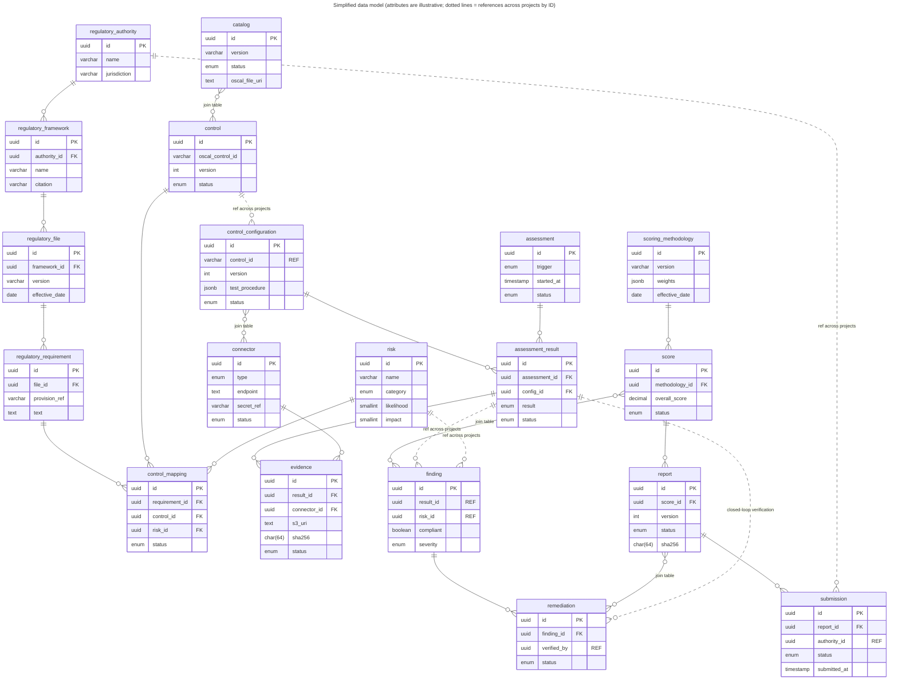

# Data model

Each project owns its own databases. Links between projects are identifiers (marked **REF**),
read through the owning project's internal service API, not foreign keys.

## Simplified data model

**Figure 14.1: Simplified data model**

<!-- mermaid-source: assets/diagrams/data-model/fig-14-1-simplified-data-model.mmd -->

<!-- /mermaid-source -->

Files: [SVG](../assets/diagrams/data-model/fig-14-1-simplified-data-model.svg) · [PNG](../assets/diagrams/data-model/fig-14-1-simplified-data-model.png) · [Original](../assets/diagrams/data-model/fig-14-1-simplified-data-model.original.png) · [Mermaid source](../assets/diagrams/data-model/fig-14-1-simplified-data-model.mmd)

## Complete data model

The full model is large, so it is linked rather than embedded:

**Complete data model, Projects 1, 2 and 3**

Files: [SVG](../assets/diagrams/data-model/data-model-complete.svg) · [PNG](../assets/diagrams/data-model/data-model-complete.png) · [Original](../assets/diagrams/data-model/data-model-complete.original.png) · [Mermaid source](../assets/diagrams/data-model/data-model-complete.mmd)

Per project:
- [Figure 14.2: Project 1](../systems/control-mapping/README.md#data-model)
- [Figure 14.3: Project 2](../systems/continuous-compliance/README.md#data-model)
- [Figure 14.4: Project 3](../systems/risk-reporting/README.md#data-model)

Self-referencing links: `regulatory_file.supersedes_file_id`, `regulatory_requirement.parent_requirement_id`,
`control.parent_control_id` (control enhancements), `control_group.parent_group_id`, `catalog.previous_catalog_id`.
