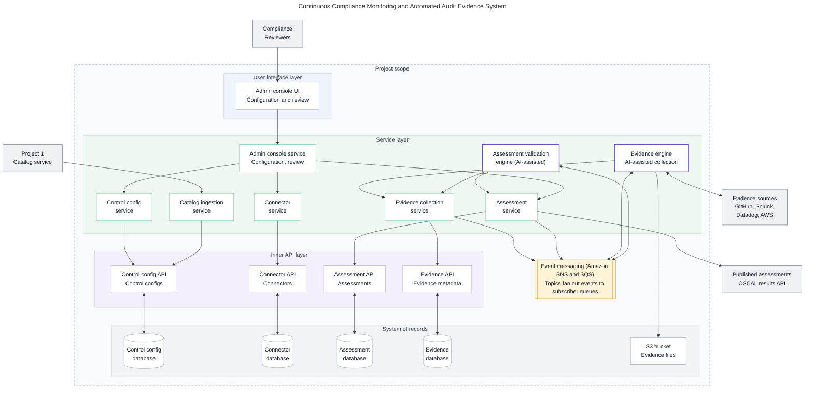
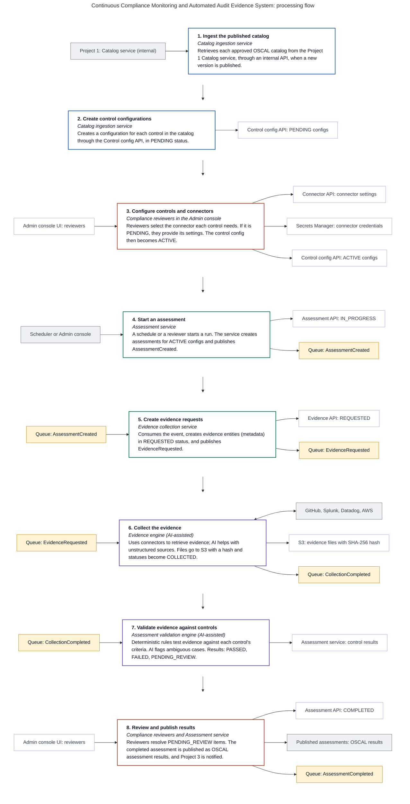
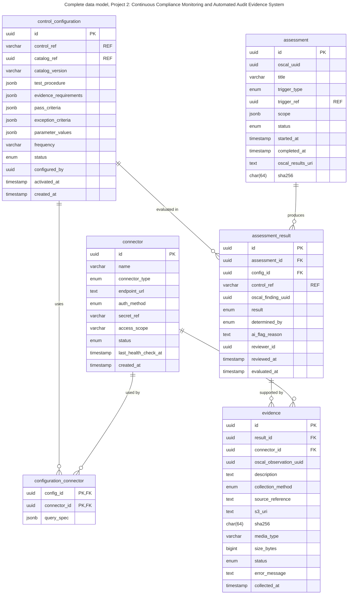

# Project 2: Continuous Compliance Monitoring and Automated Audit Evidence System

Ingests the OSCAL catalogs published by Project 1, configures a test and connectors for each control, collects evidence automatically from sources such as GitHub, Splunk, Datadog and AWS, validates it against each control, and publishes OSCAL assessment results.

## Architecture

**Figure 11.1: Proposed high-level software architecture**

<!-- mermaid-source: assets/diagrams/continuous-compliance/fig-11-1-architecture.mmd -->

<!-- /mermaid-source -->

Files: [SVG](../../assets/diagrams/continuous-compliance/fig-11-1-architecture.svg) · [PNG](../../assets/diagrams/continuous-compliance/fig-11-1-architecture.png) · [Original](../../assets/diagrams/continuous-compliance/fig-11-1-architecture.original.png) · [Mermaid source](../../assets/diagrams/continuous-compliance/fig-11-1-architecture.mmd)

## Processing flow

**Figure 11.2: Proposed processing flow**

<!-- mermaid-source: assets/diagrams/continuous-compliance/fig-11-2-processing-flow.mmd -->

<!-- /mermaid-source -->

Files: [SVG](../../assets/diagrams/continuous-compliance/fig-11-2-processing-flow.svg) · [PNG](../../assets/diagrams/continuous-compliance/fig-11-2-processing-flow.png) · [Original](../../assets/diagrams/continuous-compliance/fig-11-2-processing-flow.original.png) · [Mermaid source](../../assets/diagrams/continuous-compliance/fig-11-2-processing-flow.mmd)

## Data model

**Figure 14.3: Complete data model, Project 2**

<!-- mermaid-source: assets/diagrams/continuous-compliance/fig-14-3-data-model.mmd -->

<!-- /mermaid-source -->

Files: [SVG](../../assets/diagrams/continuous-compliance/fig-14-3-data-model.svg) · [PNG](../../assets/diagrams/continuous-compliance/fig-14-3-data-model.png) · [Original](../../assets/diagrams/continuous-compliance/fig-14-3-data-model.original.png) · [Mermaid source](../../assets/diagrams/continuous-compliance/fig-14-3-data-model.mmd)

## Related
- [Solution architecture](../../architecture/README.md)
- [Simplified data model](../../data-model/README.md)
- [Roadmap](../../architecture/roadmap.md)
