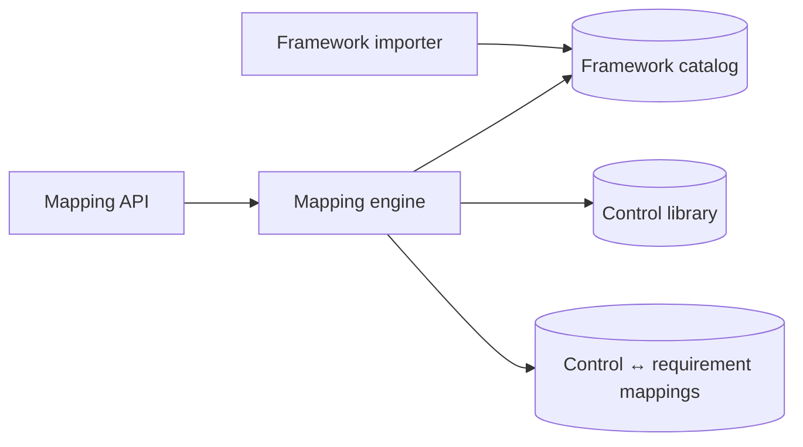

# Federated Regulatory Control Mapping System

**Initiative:** Control Mapping

## Purpose
_One paragraph: what problem this system solves and for whom._

## Scope
- In scope: _..._
- Out of scope: _..._

## Components

## Key flows
- [Framework import and control mapping](../../flows/control-mapping-flow.md)

## Interfaces
| Interface | Direction | Description |
|---|---|---|
| _REST /api/..._ | inbound | _..._ |
| _event ..._ | outbound | _..._ |

## Related
- [Containers](../../architecture/02-containers.md)
- ADRs: _link relevant ADRs_
