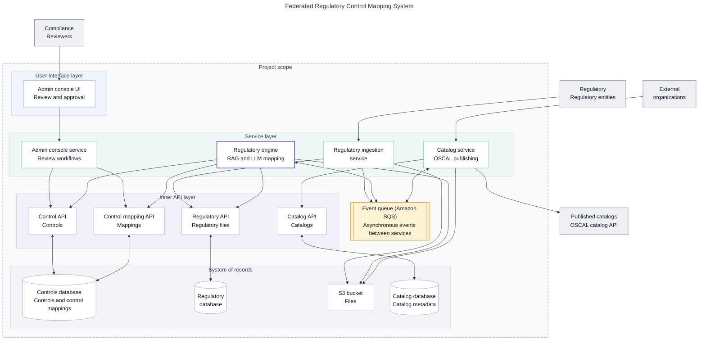
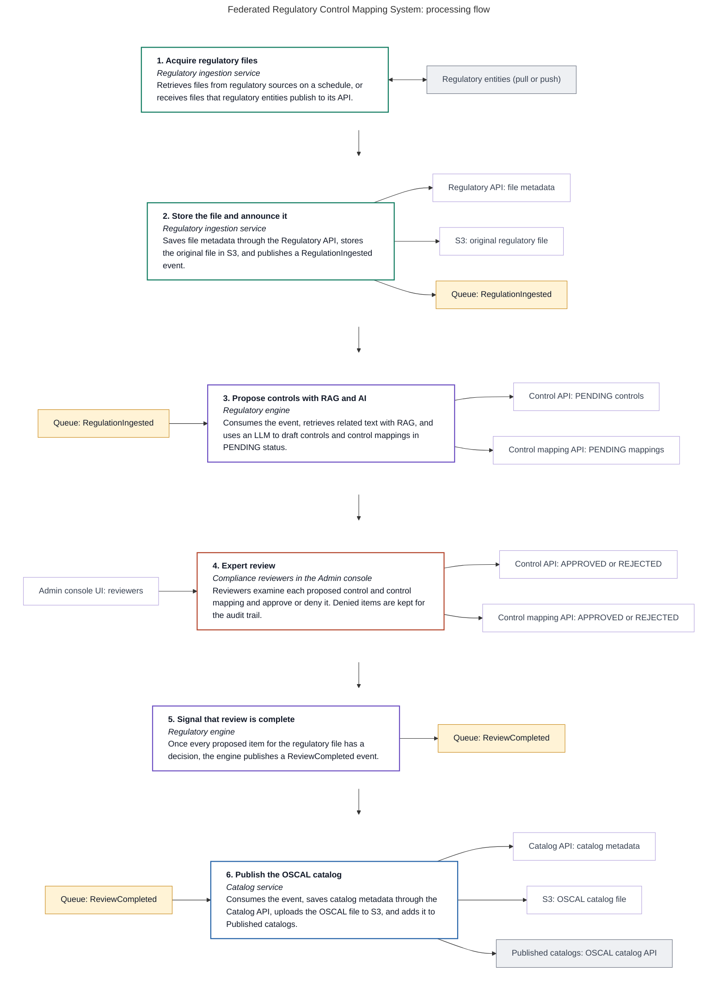
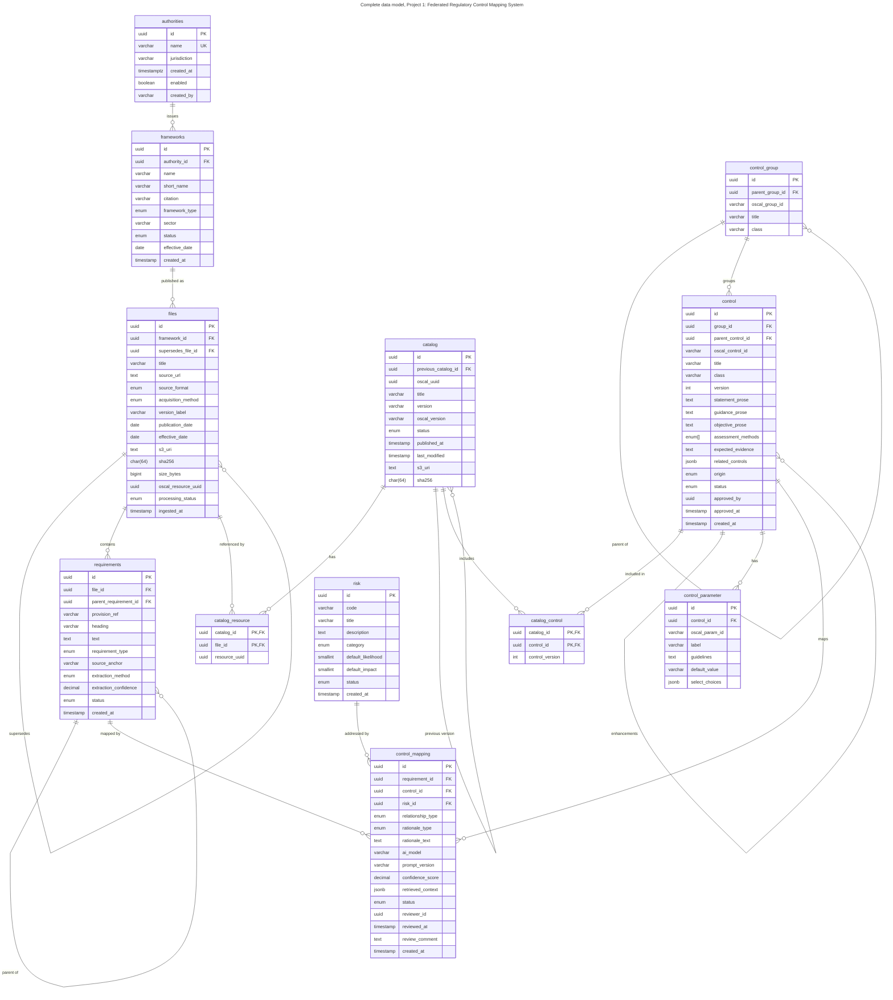

# Project 1: Federated Regulatory Control Mapping System

Acquires regulatory files, uses retrieval-augmented generation (RAG) and an LLM to propose controls and control mappings, routes every proposal through expert review, and publishes approved results as OSCAL catalogs.

## Architecture

**Figure 10.1: Proposed high-level software architecture**

<!-- mermaid-source: assets/diagrams/control-mapping/fig-10-1-architecture.mmd -->

<!-- /mermaid-source -->

Files: [SVG](../../assets/diagrams/control-mapping/fig-10-1-architecture.svg) · [PNG](../../assets/diagrams/control-mapping/fig-10-1-architecture.png) · [Original](../../assets/diagrams/control-mapping/fig-10-1-architecture.original.png) · [Mermaid source](../../assets/diagrams/control-mapping/fig-10-1-architecture.mmd)

## Processing flow

**Figure 10.2: Proposed processing flow**

<!-- mermaid-source: assets/diagrams/control-mapping/fig-10-2-processing-flow.mmd -->

<!-- /mermaid-source -->

Files: [SVG](../../assets/diagrams/control-mapping/fig-10-2-processing-flow.svg) · [PNG](../../assets/diagrams/control-mapping/fig-10-2-processing-flow.png) · [Original](../../assets/diagrams/control-mapping/fig-10-2-processing-flow.original.png) · [Mermaid source](../../assets/diagrams/control-mapping/fig-10-2-processing-flow.mmd)

## Data model

**Figure 14.2: Complete data model, Project 1**

<!-- mermaid-source: assets/diagrams/control-mapping/fig-14-2-data-model.mmd -->

<!-- /mermaid-source -->

Files: [SVG](../../assets/diagrams/control-mapping/fig-14-2-data-model.svg) · [PNG](../../assets/diagrams/control-mapping/fig-14-2-data-model.png) · [Original](../../assets/diagrams/control-mapping/fig-14-2-data-model.original.png) · [Mermaid source](../../assets/diagrams/control-mapping/fig-14-2-data-model.mmd)

## Related
- [Solution architecture](../../architecture/README.md)
- [Repositories](../../architecture/repositories.md): where the code for each component lives
- [Simplified data model](../../data-model/README.md)
- [Roadmap](../../architecture/roadmap.md)
