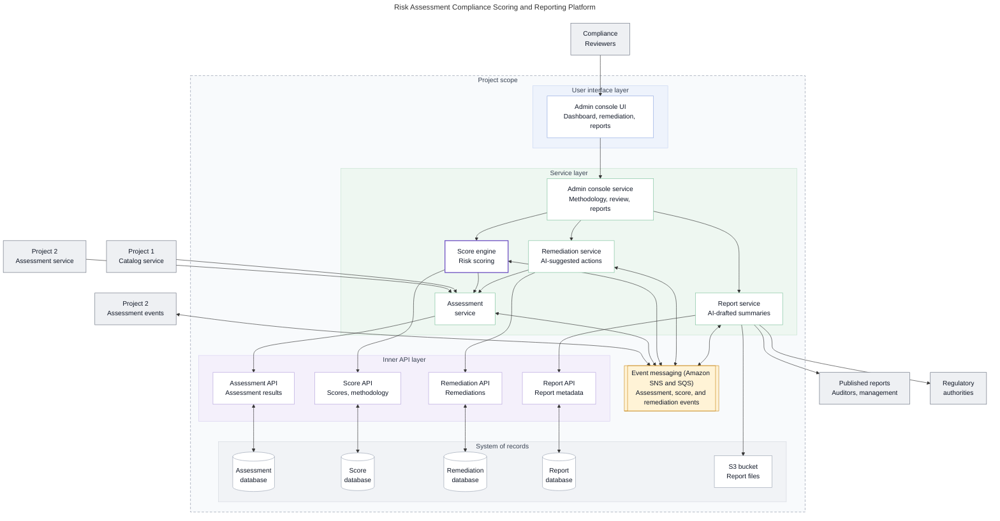
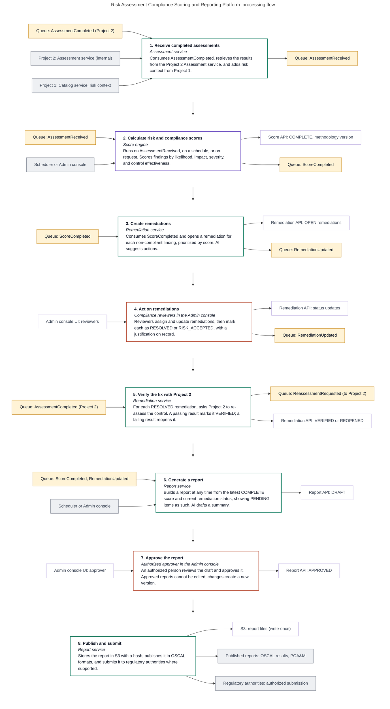
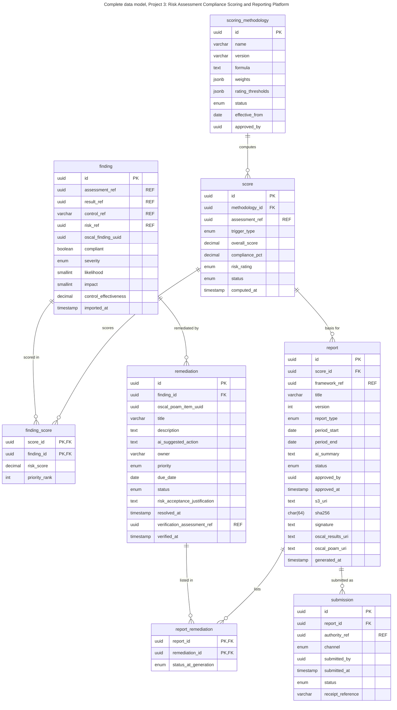

# Project 3: Risk Assessment Compliance Scoring and Reporting Platform

Receives completed assessments from Project 2, scores risk and compliance with a versioned methodology, opens remediations and verifies fixes by requesting re-assessment from Project 2, and publishes approved reports as OSCAL assessment results and POA&M.

## Architecture

**Figure 12.1: Proposed high-level software architecture**

<!-- mermaid-source: assets/diagrams/risk-reporting/fig-12-1-architecture.mmd -->

<!-- /mermaid-source -->

Files: [SVG](../../assets/diagrams/risk-reporting/fig-12-1-architecture.svg) · [PNG](../../assets/diagrams/risk-reporting/fig-12-1-architecture.png) · [Original](../../assets/diagrams/risk-reporting/fig-12-1-architecture.original.png) · [Mermaid source](../../assets/diagrams/risk-reporting/fig-12-1-architecture.mmd)

## Processing flow

**Figure 12.2: Proposed processing flow**

<!-- mermaid-source: assets/diagrams/risk-reporting/fig-12-2-processing-flow.mmd -->

<!-- /mermaid-source -->

Files: [SVG](../../assets/diagrams/risk-reporting/fig-12-2-processing-flow.svg) · [PNG](../../assets/diagrams/risk-reporting/fig-12-2-processing-flow.png) · [Original](../../assets/diagrams/risk-reporting/fig-12-2-processing-flow.original.png) · [Mermaid source](../../assets/diagrams/risk-reporting/fig-12-2-processing-flow.mmd)

## Data model

**Figure 14.4: Complete data model, Project 3**

<!-- mermaid-source: assets/diagrams/risk-reporting/fig-14-4-data-model.mmd -->

<!-- /mermaid-source -->

Files: [SVG](../../assets/diagrams/risk-reporting/fig-14-4-data-model.svg) · [PNG](../../assets/diagrams/risk-reporting/fig-14-4-data-model.png) · [Original](../../assets/diagrams/risk-reporting/fig-14-4-data-model.original.png) · [Mermaid source](../../assets/diagrams/risk-reporting/fig-14-4-data-model.mmd)

## Related
- [Solution architecture](../../architecture/README.md)
- [Simplified data model](../../data-model/README.md)
- [Roadmap](../../architecture/roadmap.md)
